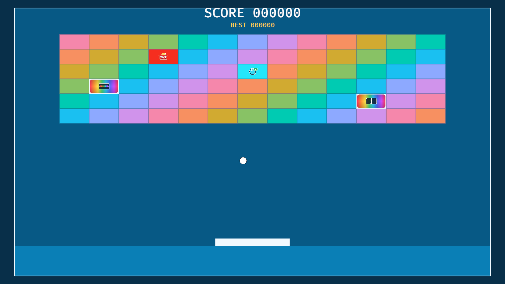

# Rust + Bevy Breakout: Modular Architecture & Gameplay Enhancements

An extended version of the open-source [Block Breaker / Breakout game](https://github.com/rust-adventure/block-breaker), originally created by [Christopher Biscardi](https://github.com/ChristopherBiscardi). This contribution focuses on a more modular codebase and additional arcade mechanics while aiming to preserve the original gameplay.

## Gameplay Preview

  

## How to Play

- **Move the paddle:** Use the **Left** and **Right arrow keys** to move horizontally.
- **Restart the game:** Press **`R`**.

## Project Overview

This project builds on the original game rather than replacing its core gameplay. The work focuses on two areas:

1. Organizing the Rust codebase into a more modular, maintainable structure.
2. Adding special bricks, gameplay mechanics, and visual feedback.

## Gameplay Enhancements

### Animated Score and Session High Score

- Added animation to make score updates more noticeable.
- Added a display for the highest score achieved during the current session.
- Preserved the existing scoring rules:
  - **15 points** for breaking one brick.
  - **50 points** for breaking two bricks simultaneously.
  - **100 points** for breaking three or more bricks simultaneously.

### TNT Bricks

TNT bricks trigger an explosion when broken, destroying surrounding bricks and introducing an area-of-effect mechanic that can create chain reactions.

### Extra-Ball Bricks

Breaking an extra-ball brick awards an additional ball. The new ball inherits the color of the brick that triggered the reward, visually connecting the bonus to the player's action.

### Rainbow Line-Clearing Bricks

Rainbow bricks provide two special clearing effects:

- **Horizontal line clear:** Destroys bricks across a horizontal line.
- **Vertical line clear:** Destroys bricks across a vertical line.

Their RGB linear-gradient appearance helps distinguish them from standard bricks.

### Special-Brick Assets

Supporting visual assets are organized by type:

- `assets/icons/` — icons for identifying special bricks.
- `assets/textures/` — gradient textures used by the special-brick visuals.

## Code Organization

The refactored codebase uses Bevy's plugin-based architecture to separate application setup, configuration, gameplay, and UI responsibilities. The intended high-level organization is:

- **`app`** — application initialization and setup.
- **`config`** — shared game configuration and constants.
- **`game`** — gameplay entities, components, systems, and mechanics.
- **`ui`** — interface elements, including score display and related feedback.

The refactored version contains 20 Rust source files, reflecting the move toward a more structured codebase.

### Architectural Goals

- Separate application setup from gameplay implementation.
- Keep configuration and gameplay constants organized.
- Group related components and systems by responsibility.
- Make features easier to extend and maintain.
- Provide a clearer foundation for future mechanics.
- Avoid unnecessary dependencies and preserve existing gameplay behavior.

## Existing Gameplay Preserved

The enhancements are intended to preserve the original game's core behavior, including:

- Horizontal paddle movement using the arrow keys.
- Wave-based progression and respawning behavior.
- Existing gameplay constants and scoring rules.
- Existing audio assets and sound-related functionality.

The goal is to extend the original experience without changing its fundamental design.

## Credits

The original open-source game is available in the [Block Breaker repository](https://github.com/rust-adventure/block-breaker) and was created by [Christopher Biscardi](https://github.com/ChristopherBiscardi).

This work extends the original project with organizational improvements and additional gameplay features; it does not claim authorship of the original game. Thank you to Christopher for publishing the project and making it possible for others to learn from, experiment with, and build upon it.
